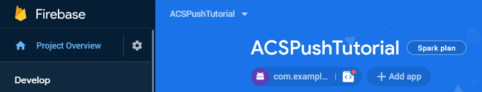
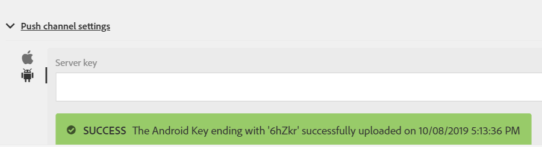

# Etapa 1 - Criando o aplicativo [!DNL Android] e configurando para usar [!DNL Firebase Cloud Messaging]

Nesta parte, você criará o aplicativo [!DNL Android] para receber [!UICONTROL Push notifications] enviado do Adobe Campaign Standard. Para receber as notificações por push, o aplicativo precisa ser registrado com o [!DNL Firebase Cloud Service] da Google.

1. Faça logon na sua conta do [!DNL Firebase].

   O [!DNL Firebase] é a plataforma móvel da Google que ajuda você a desenvolver aplicativos de alta qualidade. Se você não tiver uma conta [!DNL Firebase], crie um [daqui](https://firebase.google.com).

2. Iniciar [!DNL Android Studio]
3. Clique em **[!UICONTROL File]** > **[!UICONTROL New]** > **[!UICONTROL New Project].**
4. Selecione **[!UICONTROL Empty Activity]** e clique em **[!UICONTROL Next].**

   

5. Forneça um nome significativo para o projeto.

   Para o propósito desta demonstração, nomeamos nosso projeto como *[!DNL ACSPushTutorial]*

   

6. Aceite os nomes de pacote padrão e clique em **[!DNL Finish]** para criar seu projeto.
7. A estrutura do projeto deve ser semelhante à captura de tela abaixo

   

8. Clique em **[!UICONTROL Tools]** > **[!UICONTROL Firebase].** (isso adiciona o projeto a [!DNL Firebase])
9. Clique em **[!UICONTROL Set up Firebase Cloud Messaging].**

   

10. Clique em **[!UICONTROL Connect to Firebase].**
11. Depois que seu aplicativo for conectado ao Firebase, clique em **[!UICONTROL Add FCM to your app].**
12. Clique em **[!UICONTROL Accept Changes].**

    Quando você está adicionando o FCM ao aplicativo, o assistente precisa de sua permissão para fazer algumas alterações no projeto.

    ![[!DNL add-fcm-to-your-app]](assets/firebase-add-fcm-to-app.PNG)

Ao integrar com êxito seu aplicativo ao Firebase, você deve receber uma mensagem como a mostrada abaixo:

![[!DNL fcm-successfull]](assets/android-firebase-success.PNG)

[Verifique se o projeto está listado no console  [!DNL Firebase &#x200B;]](https://console.firebase.google.com/)

## Definir Configurações de [!UICONTROL Push Channel]

1. Fazer logon no console [!DNL Firebase]
2. Abra o projeto **[!UICONTROL ACSPushTutorial]**.
3. Clique no **ícone de engrenagem** e abra as configurações do projeto

   

4. Vá até a guia **[!UICONTROL Cloud Messaging]**.
5. Copiar a chave do servidor

   

6. Faça logon na sua instância do Adobe Campaign Standard
7. Clique em **[!UICONTROL Adobe Campaign]** > **[!UICONTROL Administration]** > **[!UICONTROL Channels]** > **[!UICONTROL Mobile App].**
8. Selecione o **[!UICONTROL Mobile Application Property].** apropriado
9. Clique no ícone **[!DNL Android]** na seção **[!UICONTROL Push Channel settings]**.
10. Cole a chave do servidor no campo de chave do servidor.

Se tudo correr bem, você verá uma mensagem de SUCESSO.

Para resumir, criamos um [!DNL Android App] e conectamos o [!DNL Android App] com [!DNL Firebase]. Em seguida, conectamos o Aplicativo Móvel no Adobe Campaign com o [!DNL Android App] colando a chave do servidor do Aplicativo [!DNL Android] no Aplicativo Móvel no Adobe Campaign Standard.
