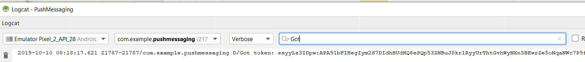
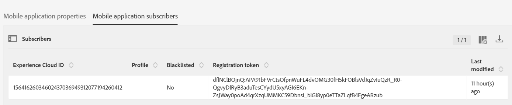

# Etapa 4 - Definir [!DNL pushidentifier]

O **[!DNL pushidentifier]** é uma cadeia de caracteres que contém o token do dispositivo para notificações [!DNL Push]. É o mesmo token enviado por [!DNL Firebase] e passado para a SDK usando o método [!DNL MobileCore.setPushIdentifier].

Abra o projeto no [!DNL Android™]studio. Exclua todo o código em [!DNL MainActivity] **exceto a primeira linha que é a instrução do pacote**.

Cole o código a seguir em [!DNL MainActivity]:

<!--
Removed `{.line-numbers}` below
-->

```java
import androidx.annotation.NonNull;
import androidx.appcompat.app.AppCompatActivity;

import android.os.Bundle;
import android.util.Log;
import android.widget.Toast;

import com.adobe.marketing.mobile.MobileCore;
import com.google.android.gms.tasks.OnCompleteListener;
import com.google.android.gms.tasks.Task;
import com.google.firebase.iid.FirebaseInstanceId;
import com.google.firebase.iid.InstanceIdResult;

public class MainActivity extends AppCompatActivity {

@Override
protected void onCreate(Bundle savedInstanceState) {
super.onCreate(savedInstanceState);
setContentView(R.layout.activity_main);

registerToken();
}

void registerToken() {
FirebaseInstanceId.getInstance().getInstanceId()
    .addOnCompleteListener(new OnCompleteListener<InstanceIdResult>() {
        @Override
        public void onComplete(@NonNull Task<InstanceIdResult> task) {
            if (!task.isSuccessful()) {
                Log.w("Message App", "getInstanceId failed", task.getException());
                return;
            }

// Get new Instance ID token
String token = task.getResult().getToken();

Log.d("Got token", token);

MobileCore.setPushIdentifier(token);
}
});
}

@Override
public void onResume() {
super.onResume();
MobileCore.setApplication(getApplication());
MobileCore.lifecycleStart(null);
}

@Override
public void onPause() {
super.onPause();
MobileCore.lifecyclePause();
}
}
```

## Testar seu aplicativo

Agora é um bom momento para testar seu aplicativo, antes de prosseguir.

* Execute seu aplicativo clicando na seta verde ou selecione **[!DNL Run->Run'app']**.
* O emulador [!DNL Android™] deve ser iniciado e você deve ver seu aplicativo em execução com texto [!DNL "Hello World"].
* Abra a janela [!DNL logcat]. Pesquisar por &quot;[!DNL Got]&quot;. Você deve ver o token recebido de [!DNL Firebase] gravado no log como mostrado abaixo. A cadeia longa após &quot;[!DNL Got token]&quot; é o [!DNL pushidentifier] enviado ao Adobe Campaign.



### Verificar assinantes de aplicativos móveis

Faça logon na sua instância do Adobe Campaign Standard.
Navegar **[!UICONTROL Administration->Channels->Mobile App(Experience Platform SDK)]**. Abra o aplicativo para dispositivos móveis apropriado. Vá até a guia [!UICONTROL Mobile Application Subscribers]. Você deve ver um [!UICONTROL registration token] listado.



>[!NOTE]
>
>Se você não vir o token de registro na guia [!UICONTROL Mobile Application Subscribers], PARE aqui antes de continuar.
